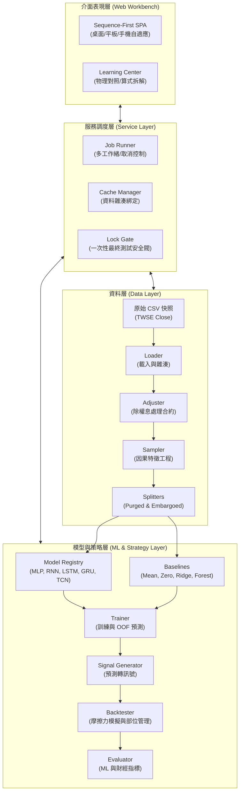
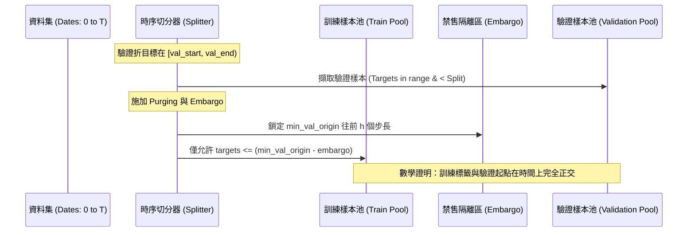
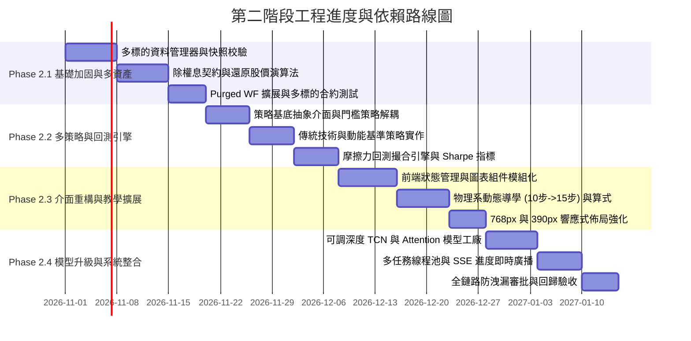

# 序列觀測站第二階段架構規劃書：多策略、多資產、資料隔離與物理系教學工作台
**TAIEX Neural Lab Phase 2 Architectural Blueprint & Review**

- **文件定位**：系統架構總綱與改版技術規範
- **審查角色**：總架構與審查員（Chief Architect & Reviewer）
- **撰寫日期**：2026-10-23
- **系統定位**：學術研究與大專物理系學生神經網路學習工作台（Strictly for Academic & Educational Research）
- **基準版本**：基於現有 `taiex-neural-lab`（FastAPI + PyTorch + Vanilla JS）程式碼審查現況

---

## 目錄

1. [執行摘要與改版願景](#1-執行摘要與改版願景)
2. [現行系統架構與模組邊界審查（As-Is Audit）](#2-現行系統架構與模組邊界審查as-is-audit)
3. [第二階段模組邊界重構與解耦設計（To-Be Architecture）](#3-第二階段模組邊界重構與解耦設計to-be-architecture)
4. [核心規範與契約（Contracts Specification）](#4-核心規範與契約contracts-specification)
5. [資料隔離與防作弊安全機制（Anti-Leakage Protocols）](#5-資料隔離與防作弊安全機制anti-leakage-protocols)
6. [物理系教學流程與 UI/UX 深度體驗設計](#6-物理系教學流程與-uiux-深度體驗設計)
7. [分階段實施路線圖與工作相依圖（Roadmap & Dependencies）](#7-分階段實施路線圖與工作相依圖roadmap--dependencies)
8. [建議項目與驗收條件對應表（Acceptance Criteria Mapping Matrix）](#8-建議項目與驗收條件對應表acceptance-criteria-mapping-matrix)
9. [擴充風險、限制與非目標（Risks, Limitations & Non-Goals）](#9-擴充風險限制與非目標risks-limitations--non-goals)

---

## 1. 執行摘要與改版願景

### 1.1 核心使命
`taiex-neural-lab` 是專為具備微積分、線性代數與統計物理基礎的物理系學生量身打造之本機神經網路研究工作台。第一階段（Phase 1）已成功實作單一標的（TAIEX）與固定熱門大型股收盤價的時間序列預測、Purged Walk-Forward 驗證、五種神經網路架構（MLP, RNN, LSTM, GRU, TCN）、NumPy 手算梯度與 PyTorch autograd 數值對驗、以及 10 步引導式教學。

第二階段（Phase 2）的核心願景為：**在維持極嚴格的學術研究邊界與防洩漏約束下，將單一標的實驗台演進為兼具「多策略比較」、「多檔個股橫斷面」、「自適應 UI/UX」、「零洩漏資料隔離」與「物理隱喻深度教學」的可交付架構**。

> [!IMPORTANT]
> **學術與倫理邊界**：本系統所有預測、訊號與指標均為統計實驗與模型檢驗，**嚴禁用於真實市場交易指導或任何商業投資宣稱**。第二階段之所有改動必須持續標示資料雜湊、有限樣本限制與交易摩擦成本，徹底杜絕金融行銷常見之過度擬合與倖存者偏差。

---

## 2. 現行系統架構與模組邊界審查（As-Is Audit）

本節基於對現行實際程式碼（`app/data.py`、`app/ml.py`、`app/main.py`、`web/`、`tests/`）之逐行審查，忠實記錄現況。

### 2.1 現行檔案結構與模組職責
```
taiex-neural-lab/
├── app/
│   ├── __init__.py
│   ├── __main__.py       # CLI 啟動入口 (uvicorn app.main:app)
│   ├── data.py           # 資料載入、TWSE 抓取、樣本建立、Purged WF 切分
│   ├── ml.py             # PyTorch 模型定義、訓練循環、傳統基準、指標計算、NumPy trace
│   └── main.py           # FastAPI 路由、線程池任務佇列、鎖定測試狀態控制
├── web/
│   ├── index.html        # 單頁應用 HTML 結構、SVG 容器、學習中心
│   ├── app.js            # 前端狀態機、REST API 呼叫、圖表繪製、導學邏輯
│   └── styles.css        # 全域 CSS 變數、Sequence-first 佈局、響應式斷點
├── tests/
│   ├── test_data_guard_contracts.py  # 合成資料因果性、標籤對齊、隔離契約測試
│   └── test_system.py                # 系統級端到端驗證、模型梯度回傳、TCN 因果性測試
├── scripts/
│   ├── regression_monitor.py         # 包含瀏覽器、UI、無障礙性之全面回歸監控腳本
│   └── synthetic_regression.py      # 無 I/O、純合成資料之確定性快速煙霧檢查腳本
└── data/
    ├── taiex_close.csv               # TAIEX 歷史收盤資料快照 (2010 起)
    ├── metadata.json                 # 資料來源中繼資料
    ├── stocks/                       # 熱門大型股本機快照目錄 (*_close.csv, *.json)
    └── final-test-*.json             # [受保護區] 鎖定測試曝光紀錄狀態 (禁止探測/篡改)
```

### 2.2 現行模組實作細節與合約檢驗

#### A. 資料模組（`app/data.py`）
1. **資料來源與格式限制**：
   - 僅支援 `date,close` 兩欄位之日收盤價。不支援 OHLC、成交量或逐筆撮合。
   - 資料門檻硬性限制至少 800 個交易日（`len(dates) < 800` 拋出 `ValueError`）。
   - 個股清單為固定的 10 檔大型股池（`POPULAR_STOCKS`，如 2330.TW、2317.TW 等），使用未除權息收盤價，面臨除權息除息造成的假跳空風險。
2. **樣本建構與因果對齊（`build_samples`）**：
   - 特徵集包括 `return_1`, `return_5`, `return_20`, `volatility_5`, `volatility_20`。
   - 因果暖機列計算：`latest_warmup = max(warmup_by_feature[key])`，起點 `start = max(lookback - 1, latest_warmup + lookback - 1)`。
   - 執行假設與標籤定義：收盤 $t$（`origin`）產生訊號，次日收盤 $t+1$（`entry`）進場，第 $t+1+h$ 日收盤（`target`）出場。目標報酬率為 $C_{t+h+1}/C_{t+1}-1$（或對數版本），嚴格符合次日收盤執行假設（`next_close`）。
3. **資料切分與隔離（`walk_forward_folds`）**：
   - 前 80% 作為訓練／驗證池，後 20% 為鎖定測試保留區（`split_index = int(len(series.dates) * 0.8)`）。
   - 採用 López de Prado (2018) 之 Purged Walk-Forward。
   - 驗證集標籤硬性限制 `targets < split`。
   - 訓練集與驗證集之間設有 Embargo 隔離期：`targets <= min_val_origin - embargo`（`embargo = min(5, horizon) if horizon > 1 else 0`），徹底杜絕重疊標籤自相關洩漏。

#### B. 機器學習與評估模組（`app/ml.py`）
1. **模型架構**：
   - `MLP`：具備動態多層隱藏層寬度、ReLU、Dropout。
   - `RNN / LSTM / GRU`：單層或多層循環單元，取序列末端向量輸入線性層。
   - `TCN`：兩個因果殘差卷積區塊（`_CausalConv1d`），膨脹係數 1 與 2，GELU 激活，具備 `prefix_representation` 供因果防洩漏驗證。
2. **數值標準化與技巧**：
   - 特徵 Z-score 標準化僅在該折訓練集 fit：`scale = np.where(scale < 1e-8, 1.0, scale)`。
   - 目標報酬率縮放 100 倍（`target_scale = 100.0`），預防金融微小報酬率（方差 $\approx 10^{-4}$）造成的梯度消失，推論時除回。
   - 梯度剪裁（`clip_grad_norm_ <= 5.0`）。
3. **基準模型（Baselines）**：
   - 實作了「歷史平均（`historical_mean`）」、「零報酬預測（`naive`）」、「Ridge 線性迴歸」與「Random Forest」。
4. **指標體系**：
   - `mae`, `rmse`（以百分點表示）、`r2`、`spearman`、以及 `directionAccuracy`（預測為 0 給予 0.5 分）。
5. **教學對驗（`numpy_mlp_trace`）**：
   - 獨立的 3-2-1 tanh MLP，NumPy 解析推導矩陣梯度，並以 `gradientMaxAbsError` 比對 PyTorch autograd，數值誤差小於 $10^{-12}$。

#### C. API 服務與非同步排程（`app/main.py`）
1. **工作排程模型**：
   - 使用單一執行緒池 `ThreadPoolExecutor(max_workers=1)`，一次僅允許單一訓練或更新工作執行。
   - 使用 `jobs_lock` 與 `refresh_in_progress` 保障資料刷新與訓練的互斥。
2. **鎖定測試保護閘門（Lock Gate）**：
   - `/api/data/lock-status` 僅回傳狀態中繼（`available` 或 `spent`），絕不外洩測試集數值。
   - `/api/final-evaluation` 嚴格要求：必須先完成全特徵與參數一致的 walk-forward 驗證；訓練輪數需 $\ge 20$ epoch；禁止 TCN 進入鎖定測試；一旦執行即將狀態標記為 `spent`，不得重複執行。

### 2.3 現行瓶頸與架構債審查（Bottlenecks）
- **瓶頸 1（單一標的隔離運算）**：目前只能單檔執行 walk-forward，無法進行跨個股之橫斷面排序、多標的投資組合或產業輪動實驗。
- **瓶頸 2（價格未除權息）**：個股未納入還原股價，遇到現金股利發放或除權時會產生人為的單日大跌假訊號。
- **瓶頸 3（策略層耦合於預測門檻）**：目前回測僅在 `app/main.py` 中以 `buyThreshold` 與 `sellThreshold` 做簡單三元分類，缺乏多均線、動能過濾、部位管理與交易手續費／滑價之策略抽象層。
- **瓶頸 4（單工作緒佇列）**：`max_workers=1` 在多標的實驗時將造成使用者等待過久，缺乏多工作緒或多行程批次運算能力。
- **瓶頸 5（前端單一狀態檔案）**：`web/app.js` 達 14 萬位元組，圖表渲染、事件處理與導學狀態混雜，缺乏清晰的 Model-View-Presenter 模組化結構。

---

## 3. 第二階段模組邊界重構與解耦設計（To-Be Architecture）

第二階段將採取「**漸進式解耦（Incremental Decoupling）**」策略，在完全相容既有 API 與測試的前提下，重構為分層清晰的微核心架構。

### 3.1 目錄結構規劃（建議重構拓撲）
```
taiex-neural-lab/
├── app/
│   ├── core/                  # 核心共用設定、例外與型別定義
│   │   ├── config.py
│   │   └── exceptions.py
│   ├── data/                  # 資料領域模組
│   │   ├── loader.py          # CSV 與快照載入、雜湊校驗
│   │   ├── universe.py        # 標的管理（TAIEX + 擴展大型股池）
│   │   ├── adjuster.py        # [新增建議] 除權息調整與還原股價演算法
│   │   ├── sampler.py         # 橫斷面與時序樣本建構
│   │   └── splitters.py       # Purged Walk-Forward 與時序切分契約
│   ├── ml/                    # 機器學習核心
│   │   ├── models/            # 模組化神經網路工廠 (MLP, RNN, LSTM, GRU, TCN, Attention)
│   │   ├── baselines/         # 統計與機器學習基準模型 (Ridge, Forest, ARIMA 建議)
│   │   ├── trainer.py         # 訓練器、早停、學習率調度
│   │   ├── metrics.py         # 多維度財務與機器學習評估指標
│   │   └── teaching.py        # 物理/數學對照教學追蹤 (NumPy vs Autograd)
│   ├── strategies/            # [新增建議] 量化策略與回測引擎
│   │   ├── base.py            # 策略基底類別與訊號契約
│   │   ├── threshold.py       # 既有預測門檻策略
│   │   ├── momentum.py        # [新增建議] 橫斷面動能與時序動能策略
│   │   ├── technical.py       # [新增建議] 傳統技術指標策略 (MA, RSI, 波動率濾網)
│   │   └── backtester.py      # [新增建議] 離散事件驅動之次日收盤撮合引擎
│   ├── services/              # 應用與排程服務
│   │   ├── job_runner.py      # 異步任務排程器 (支援取消與進度回報)
│   │   ├── cache_manager.py   # 驗證結果與資料雜湊快取
│   │   └── lock_gate.py       # 鎖定測試審批與物理隔離閘門
│   └── main.py                # FastAPI 路由聚合與依賴注入
├── web/
│   ├── index.html
│   ├── styles.css
│   └── js/                    # [前端重構建議]
│       ├── store.js           # 集中式狀態管理
│       ├── api.js             # REST API 客戶端
│       ├── charts/            # 圖表繪製模組 (SeriesChart, LossChart, ResidualChart)
│       └── views/             # 視圖控制器 (Workbench, Learning, Strategy)
```

### 3.2 各子模組邊界與職責劃分



---

## 4. 核心規範與契約（Contracts Specification）

為了確保多模組協作的嚴密性與確定性，系統內各模組間交互必須嚴格遵循以下合約。

### 4.1 資料契約（Data Contract）

#### A. 價格序列輸入綱要（Price Series Schema）
```python
# 建議定義於 app.data.schema
from dataclasses import dataclass
import numpy as np

@dataclass(frozen=True)
class PriceSeriesRecord:
    dates: list[str]          # ISO 8601 'YYYY-MM-DD'，嚴格遞增且無重複
    unadjusted_close: np.ndarray  # float64，原始日收盤價（正數且有限值）
    adjusted_close: np.ndarray    # float64，還原權值收盤價（建議新增）
    symbol: str               # 標的代碼，例如 'TAIEX', '2330.TW'
    dataset_hash: str         # 該標的資料來源檔案之 SHA-256
    source_metadata: dict     # 資料來源中繼資訊
```

#### B. 特徵因果性保證（Causality Contract）
- **約束**：在時刻 $t$ 生成之特徵向量 $\mathbf{x}_t$，**其數學計算必須僅依賴於時刻 $s \le t$ 之資訊**。
- **驗證斷言**：若故意修改 $t+1$ 及其後之價格，特徵 $\mathbf{x}_t$ 數值必須完全保持不變（由 `tests/test_system.py::test_targets_use_future_close_but_features_stop_at_origin` 規範）。

#### C. 標籤與執行時間軸契約（Target Alignment Contract）
- **預測時間點（Signal Origin）**：交易日 $t$ 收盤後。
- **進場執行點（Execution Entry）**：交易日 $t+1$ 收盤 $C_{t+1}$（簡化但現實的次日收盤假設）。
- **出場結算點（Execution Exit）**：持有 $h$ 個交易日後，於交易日 $t+1+h$ 收盤 $C_{t+1+h}$。
- **目標報酬率公式**：
  $$\text{Simple Return: } Y_t = \frac{C_{t+1+h}}{C_{t+1}} - 1$$
  $$\text{Log Return: } Y_t = \ln\left(\frac{C_{t+1+h}}{C_{t+1}}\right)$$

### 4.2 回測與策略契約（Backtest Contract）

#### A. 策略介面抽象（Strategy Interface）
```python
from abc import ABC, abstractmethod
import numpy as np

class BaseStrategy(ABC):
    @abstractmethod
    def generate_positions(
        self, 
        predictions: np.ndarray, 
        features: np.ndarray, 
        current_prices: np.ndarray
    ) -> np.ndarray:
        """
        輸入:
            predictions: [N] 模型預測報酬率
            features: [N, L, F] 當期特徵
            current_prices: [N] 當前收盤價
        輸出:
            target_weights: [N] 目標投資部位權重，範圍 [-1.0, 1.0]
        """
        pass
```

#### B. 交易摩擦力契約（Friction Model）
任何策略回測必須扣除以下交易摩擦成本，嚴禁零成本宣稱：
1. **券商手續費**：單邊 $0.1425\%$（可設定折讓係數，例如預設 5 折為 $0.07125\%$）。
2. **證券交易稅**：賣出時單邊收取 $0.3\%$（股票標的）或 $0.1\%$（ETF 標的）。
3. **滑價模型（Slippage）**：建議每筆進出固定收取 $0.05\%$ 或依當日波動度動態估算。

### 4.3 介面與 API 契約（API Contract）

第二階段將保留既有 `/api/experiments` 相容性，並擴展多標的與多策略路由：

| HTTP Method | API Endpoint | 請求負載摘要 | 回應合約摘要 | 狀態碼 |
|:---|:---|:---|:---|:---|
| `GET` | `/api/v2/universe` | 無 | 支援之完整標的清單、快照日期、資料雜湊 | 200 |
| `POST` | `/api/v2/experiments/walk-forward` | `symbols: list[str]`, `models: list[str]`, `features`, `lookback`, `horizon`, `training_config` | `job_id`, `status: "queued"` | 202, 409, 422 |
| `GET` | `/api/v2/jobs/{job_id}/stream` | 無（SSE 串流） | 事件流：`{percent, epoch, loss, fold, stage}` | 200 (text/event-stream) |
| `POST` | `/api/v2/strategies/evaluate` | `validation_job_id`, `strategy_type`, `params`, `fee_rate`, `tax_rate` | 回測曲線、Sharpe、MDD、總週轉率、基準比較 | 200, 404 |
| `GET` | `/api/data/lock-status` | `symbol: str` | `{"status": "available"\|"spent", "datasetHashMismatch": bool}` | 200 |
| `POST` | `/api/final-evaluation` | `symbol`, `model`, `frozen_config` | 鎖定測試唯一結果，更新狀態為 `spent` | 200, 409 |

---

## 5. 資料隔離與防作弊安全機制（Anti-Leakage Protocols）

為防止學術研究中常見之「向前看偏差（Look-ahead Bias）」與「過度調參作弊（Data Snooping）」，第二階段架構必須強制執行以下鐵律：

### 5.1 三層物理時序隔離模型
```
[========== 歷史時間軸：100% 樣本區間 ==========]
[--- 訓練集 (Train: 60%) ---][-- 驗證集 (Val: 20%) --][-- 鎖定測試集 (Test: 20%) --]
<---------------- Walk-Forward 探索選模區 -----------><-- 一次性黑盒子封存區 -->
```
1. **探索區（前 80%）**：
   - 僅能在此區進行超參數調校、特徵篩選、網路深度優化與策略規則制定。
   - 折與折之間嚴格遵循 Expanding Purged Walk-Forward，驗證集標籤絕不得超越第 80% 分界點。
2. **鎖定測試區（後 20%）**：
   - 此區為「嚴格黑盒子測試集」。
   - **禁止探測規則**：日常訓練、網頁加載、指標計算與回測引擎均不得讀取後 20% 之特徵與標籤。
   - **一次性銷毀狀態機**：一旦執行一次鎖定測試，狀態檔案即刻寫入 `status: "spent"`。後續不論是重試、更換參數或刷新資料，皆永久封鎖該標的之再次測試，杜絕 Cherry-picking。

### 5.2 Purged & Embargoed Cross-Validation 數學保證
針對重疊報酬率（Overlapping Returns，如 $h=5$ 或 $h=20$）：
- **Purging（清除）**：將所有評估期與驗證折重疊的訓練樣本標籤剔除。
- **Embargoing（禁售期）**：由於金融序列存在自相關性，驗證期結束後的緊接相鄰樣本易透過自回歸記憶洩漏資訊。因此，在驗證折結束點與下一個訓練期起點之間，強制施加長度為 $\min(5, h)$ 個交易日的冷卻空白期。



---

## 6. 物理系教學流程與 UI/UX 深度體驗設計

### 6.1 物理學與機器學習觀念對照表
為使大專物理系學生能迅速建立數理直覺，架構將核心概念與物理學建立形式對應：

| 深度學習 / 量化時序概念 | 物理學經典對應概念 | 數學形式 / 物理直覺 |
|:---|:---|:---|
| **損失函數（Loss Landscape）** | **勢能面（Potential Energy Surface）** | $L(\mathbf{w}) \sim V(\mathbf{x})$，網路尋優即粒子在阻尼介質中沿勢能梯度滑動尋求極小值。 |
| **梯度下降與動量（SGD + Momentum）** | **牛頓第二定律與阻尼運動** | $\Delta \mathbf{w}_t = \beta \Delta \mathbf{w}_{t-1} - \eta \nabla L$ 對應質點於摩擦阻力液體中之動力學方程 $m \ddot{x} + \gamma \dot{x} = -\nabla V$。 |
| **過擬合（Overfitting）** | **參數過度自由度與相空間記憶** | 類似以 100 階多項式擬合 10 個帶噪聲的量測點，相空間軌道缺乏統計泛化能力。 |
| **時間序列因果性（Causality）** | **相對論光錐與因果律** | 未來事件 $t > t_0$ 位於類空間隔之外，不可對 $t_0$ 之波函數坍縮產生任何作用量。 |
| **殘差診斷（Residual Diagnostics）** | **熱噪聲與熱力學波動耗散** | 理想殘差應為高斯白噪聲（無規熱運動）；若殘差存在肥尾或偏態，表示系統存在未捕獲之宏觀力場（漂移項）。 |

### 6.2 階梯式教學五大里程碑（Guided Curriculum）
1. **Level 1：序列的本質與尺度對稱性**
   - 探討「為何預測報酬率而非價格點位？」— 消除時間序列之單調上升非平穩漂移，求取具有統計可重複性之物理不變量。
2. **Level 2：正向動力學與逆向梯度流動**
   - 透過 NumPy 手算小型 MLP，動態觀察張量形狀、矩陣內積、ReLU 閥值開關以及反向傳播鏈式法則的數值流動。
3. **Level 3：記憶衰減與遞迴動力系統**
   - 比較 RNN 梯度消失、LSTM 門控記憶元（對應阻尼儲能器）與 TCN 因果膨脹卷積（對應有限光錐脈衝響應）。
4. **Level 4：統計泛化與殘差熱力學診斷**
   - 閱讀驗證折 running MAE、殘差直方圖與高斯常態基準曲線，理解為何方向準確率（$52\%$）看似微弱卻是真實市場極限。
5. **Level 5：金融現實與摩擦力耗散**
   - 帶入交易稅、手續費與滑價，觀察原本理論具備正期望值的微小訊號如何在熱力學摩擦力作用下迅速耗散為負期望值。

### 6.3 響應式佈局規格矩陣（UI/UX Matrix）

工作台採用 `Sequence-First` 設計語彙，針對四種主流螢幕斷點進行嚴格調適：

```
+-----------------------------------------------------------------------------------------+
|                                頂端導航與狀態列 (48px)                                   |
+-------------------+---------------------------------------------------------------------+
|                   |  條件控制列：標的、預測期、回看窗、網路參數、門檻 (90px)               |
|                   +------------------------------------+--------------------------------+
|   固定側欄        |  面板 A：收盤指數與三段時序切分     |  面板 B：神經網路結構與公式     |
|   (210px)         |  (Train 60% / Val 20% / Test 20%)  |  (即時節點拓撲、張量形狀)      |
|   - 品牌          |  [折線圖與時間軸色塊]               |  [參數摘要與即時算式]          |
|   - 導學          +------------------------------------+--------------------------------+
|   - 標的          |  面板 C：驗證指標與基準模型比較     |  面板 D：殘差分佈與逐折診斷    |
|   - 策略          |  (MAE, RMSE, 方向率, Ridge, RF)     |  (殘差直方圖、Running MAE 曲線)|
|                   +---------------------------------------------------------------------+
|                   |  底部操作列：進度條 (0-100%)、訓練模型按鈕、取消、重設 (54px)        |
+-------------------+---------------------------------------------------------------------+
```

| 設備等級 | 基準寬度 | 側欄型態 | 工作區網格佈局 | 圖表呈現適配策略 | 觸控目標尺寸 |
|:---|:---|:---|:---|:---|:---|
| **Ultra-wide / Desktop** | $\ge 1504\text{ px}$ | 固定左側（寬 210px） | 雙欄並排（62% : 38% 比例），全螢幕無主垂直捲動 | 完整高解析 SVG 折線圖、全部模型全名標籤、Tooltip 詳細資訊 | 鼠標操作，最小控制 36px |
| **Compact Desktop / Laptop** | $1024\text{ px} - 1503\text{ px}$ | 收合為小圖示欄（60px） | 雙欄適應壓縮，次要文字縮小 | SVG 動態降採樣至 500 點，指標卡維持三欄 | 最小點擊區 40px |
| **Tablet** | $768\text{ px} - 1023\text{ px}$ | 頂部漢堡選單抽屜 | 單欄垂直堆疊流式排列 | 模型比較長條圖採旋轉 45 度標籤，提供橫向捲動 | 觸控按鈕 $\ge 44\text{ px}$ |
| **Mobile** | $\le 390\text{ px}$ | 底部導航欄或抽屜 | 單欄緊湊卡片流，固定底部操作列 | 隱藏次要輔助線，模型名簡化為 4 字元代碼，提供獨立點擊放大彈窗 | 觸控按鈕 $\ge 48\text{ px}$，防遮蔽內距 |

---

## 7. 分階段實施路線圖與工作相依圖（Roadmap & Dependencies）

### 7.1 四大階段演進表



### 7.2 階段詳細說明
- **Phase 2.1：基礎加固與多資產資料引擎（P0）**
  - 重構 `app/data/` 模組，將標的管理從單純 `POPULAR_STOCKS` 陣列解耦為 `UniverseManager`。
  - 建立除權息調整合約（`adjuster.py`），明確區分未調整股價與還原權值股價。
  - 擴展 `test_data_guard_contracts.py`，加入多標的平行樣本建構與時序對齊驗證。
- **Phase 2.2：多策略與交易摩擦力回測模組（P1）**
  - 新增 `app/strategies/` 目錄，實作 `BaseStrategy` 契約。
  - 將既有門檻分類升級為具備手續費、證交稅與滑價考量之事件驅動回測器。
  - 納入「雙均線交叉」、「動能輪動」等無參數或簡單統計策略作為對照基準。
- **Phase 2.3：Sequence-First 介面重構與深度教學中心（P1）**
  - 將 `web/app.js` 拆分為 Store、API 客戶端與圖表渲染模組。
  - 升級教學中心導學流程至 15 步，新增「熱力學勢能面與梯度」、「摩擦力耗散試算」等互動練習。
  - 完善 768px（平板）與 390px（手機）端點之無遮蔽操作佈局。
- **Phase 2.4：進階模型架構與多工作緒服務調度（P2）**
  - 開放 TCN 深度與卷積核寬度配置，探索輕量級時序注意力機制（Informer/Self-Attention）。
  - 將 FastAPI 背景任務升級為支援進度串流（SSE）之多工作緒排程器。
  - 全面執行回歸測試與鎖定測試物理隔離驗收。

---

## 8. 建議項目與驗收條件對應表（Acceptance Criteria Mapping Matrix）

本表列出第二階段所有具體架構建議、對應之實作位置、前置依賴條件、以及精確的可觀察驗收方式。

| 建議編號 | 建議項目與功能描述 | 涉及模組 / 對應檔案 | 先決條件 | 可觀察之驗收結果與測試指令 |
|:---|:---|:---|:---|:---|
| **REC-01** | **多標的資料管理器解耦**：實作 `UniverseManager`，支援多檔個股快照完整性檢查、自動檢核 800 日門檻與 SHA-256 簽名。 | `app/data/universe.py`<br>`app/data/loader.py` | 無 | 執行 `pytest tests/test_system.py`：單元測試能夠無錯誤載入多檔標的，任一檔案損毀時正確觸發驗證異常。 |
| **REC-02** | **還原股價與除權息合約**：建立 `PriceAdjuster`，支援讀取 TWSE 除權除息快照，計算向前還原（Forward-adjusted）股價，消除人為假跳空。 | `app/data/adjuster.py`<br>`app/data/sampler.py` | REC-01 | 合成測試確認除權日當天特徵向量無劇烈異常跳動；對比未調整數列確認因果律不被未來除權資訊污染。 |
| **REC-03** | **橫斷面時序樣本構建器**：擴展 `build_samples` 支援多標的同時取樣，產出跨標的特徵矩陣與標籤對齊。 | `app/data/sampler.py` | REC-01, REC-02 | 驗證輸出 `samples["x"].shape == (N_samples, lookback, n_features)`，各標的日期完全對齊交易日曆。 |
| **REC-04** | **解耦量化策略基底類別**：定義 `BaseStrategy` 抽象介面，將買入／觀望／退出門檻從 API 核心抽離為獨立策略對象。 | `app/strategies/base.py`<br>`app/strategies/threshold.py` | 無 | 呼叫 `strategy.generate_positions()` 能針對任意形狀之模型預測輸出標準化部位矩陣 $[-1.0, 1.0]$。 |
| **REC-05** | **交易摩擦力與回測評估器**：實作 `BacktestEngine`，精確扣除單邊手續費（0.1425%）與證交稅（0.3%），產出 Sharpe、最大回撤（MDD）。 | `app/strategies/backtester.py`<br>`app/ml/metrics.py` | REC-04 | 測試 fixture 輸入確定性預測時，手續費與稅金之扣減與手算期望值差距 $< 10^{-6}$；零收益策略 Sharpe 為負。 |
| **REC-06** | **TCN 深度參數化與因果驗證**：允許配置 TCN 膨脹層數與通道寬度，保留 `prefix_representation` 因果測試合約。 | `app/ml/models/tcn.py`<br>`tests/test_system.py` | 無 | 執行 `pytest -k test_tcn_cannot_use_future_suffix_for_earlier_output` 通過，確認未來資料更動不影響過去時刻之特徵表示。 |
| **REC-07** | **非同步工作排程與 SSE 串流**：以多執行緒排程器取代單一全域變數，提供 Server-Sent Events (SSE) 即時推播訓練進度。 | `app/services/job_runner.py`<br>`app/main.py` | 無 | 透過 `curl -N http://127.0.0.1:8000/api/v2/jobs/{id}/stream` 能收到逐 epoch 損失與即時完成百分比 JSON 事件。 |
| **REC-08** | **前端狀態機與圖表組件化**：將 `web/app.js` 模組化拆分為 ES modules，分離資料獲取、狀態儲存與 DOM 操作。 | `web/js/store.js`<br>`web/js/api.js`<br>`web/js/charts/` | 無 | 執行 `node --check web/js/*.js` 語法檢查無誤；瀏覽器頁面無全域變數污染，Console 零 Error。 |
| **REC-09** | **響應式佈局與觸控增強**：重構 768px 平板與 390px 手機 CSS，確保按鈕高度 $\ge 44\text{px}$、圖表無橫向溢位、訓練列不遮蔽結果。 | `web/styles.css`<br>`web/index.html` | REC-08 | 執行 `scripts/regression_monitor.py`：Headless Chrome 驗證 390px 手機視口下各觸控目標與旋轉圖例全數 PASS。 |
| **REC-10** | **物理對照教學導學擴充**：學習中心擴增為 15 步，新增「勢能面梯度動態流動」與「摩擦力耗散計算」互動元件。 | `web/index.html`<br>`web/js/views/learning.js` | REC-08 | 導學能從第 1 步平順前進至第 15 步；互動輸入計算數值與物理教學指南預期值精準相符。 |
| **REC-11** | **鎖定測試實體防護驗證**：建立 CI 靜態程式碼掃描規則，嚴禁任何非指定路徑讀取 `data/final-test-*`。 | `tests/test_data_guard_contracts.py` | 無 | 執行合約測試：模擬未經驗證之設定呼叫 `/api/final-evaluation` 時，精準回傳 409 拒絕碼且無任何檔案寫入。 |

---

## 9. 擴充風險、限制與非目標（Risks, Limitations & Non-Goals）

### 9.1 擴充風險與防範策略（Risk Mitigation）
1. **TWSE 網路爬蟲限流風險（HTTP 429 Too Many Requests）**：
   - *風險*：若擴展至 50 檔個股，逐檔逐月抓取將觸發證交所 IP 封鎖。
   - *對策*：維持固定大型股快照機制，預設讀取本機 CSV；手動更新時強制設定最小間隔 3.0 秒之 Polite Delay，並支援快取中斷續傳。
2. **本機 CPU 計算資源超載風險**：
   - *風險*：學生筆記型電腦 CPU 效能有限，多標的同時訓練多層循環神經網路可能導致瀏覽器或後端當機。
   - *對策*：維持小型網路預設配置（隱藏單元 32、層數 2、epoch 25）；排程器限制最大並行工作數，並設置超時中斷保護。
3. **過擬合與虛假關聯風險（Data Snooping）**：
   - *風險*：測試過多技術指標與超參數組合，產生統計上的隨機巧合高報酬。
   - *對策*：在 UI 上強制顯示 White's Reality Check 或防過擬合警語；明確標明「多次試驗累積之泛化誤差放大效應」。

### 9.2 架構限制（Known Limitations）
- **日收盤價限制**：本系統架構基礎為日頻率收盤價（Daily Close），不適用於盤中日內交易（Intraday Tick/Minute）研究。
- **無真實開盤撮合**：所有回測均建立在「次日收盤價能以無限流動性完全成交」之理論簡化假設上，無法模擬漲跌停鎖死或流動性枯竭情境。
- **單一節點本機執行**：為保護學生隱私與簡化環境建置，系統設計為純本機單機運行，不引入 Redis、PostgreSQL 或分散式叢集。

### 9.3 明確非目標（Explicit Non-Goals）
為避免專案範疇膨脹並偏離教學本質，以下項目明確列為**非目標（Out of Scope）**：
1. **不支援真實券商下單 API 串接**：嚴禁任何自動送單、實盤下單交易功能。
2. **不宣稱具備超額阿爾法（Alpha）或商業報酬**：嚴禁在介面或文件中使用「穩賺」、「套利」、「高勝率」等宣傳用語。
3. **不建立大型雲端分散式微服務架構**：維持輕量級 FastAPI + 本機靜態檔案架構，避免學生部署門檻過高。
4. **不探測或竄改既有 `data/final-test-*` 歷史紀錄**：恪守科學研究倫理，嚴格維護鎖定測試集的物理神聖性。

---
*本架構規劃書由總架構與審查員審查現行程式碼後制定，作為 taiex-neural-lab 第二階段各項工程推進之權威驗收依據。*
